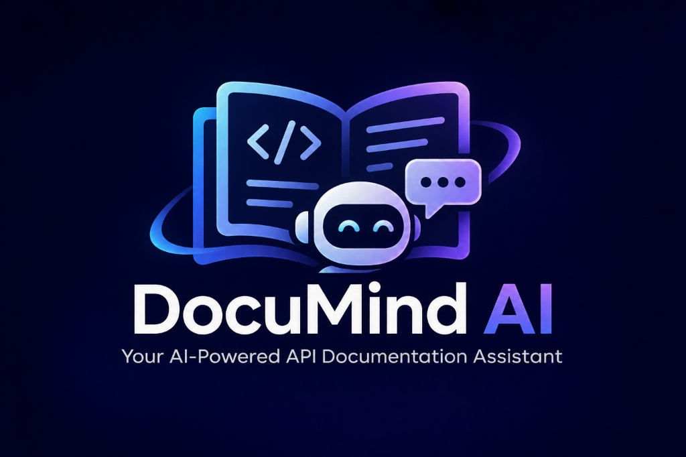
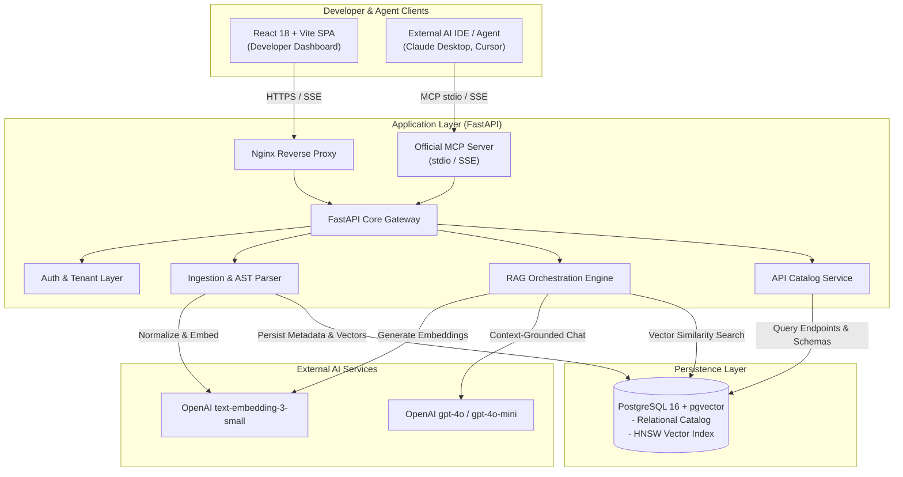

# DocuMind AI

<p align="center">
  
</p>

<h3 align="center"><strong>An AI-powered API documentation intelligence platform that enables developers to understand, explore, search, troubleshoot, and interact with API documentation using natural language.</strong></h3>

<p align="center">
  <a href="https://github.com/anmolvishvas/DocuMind-AI/actions/workflows/ci.yml"></a>
  <a href="https://www.python.org/downloads/"></a>
  <a href="https://fastapi.tiangolo.com/"></a>
  <a href="https://github.com/pgvector/pgvector"></a>
  <a href="https://modelcontextprotocol.io/"></a>
  <a href="https://react.dev/"></a>
  <a href="https://www.docker.com/"></a>
  <a href="LICENSE"></a>
</p>

---

## 📑 Core Documentation Index

This repository adheres to strict production engineering standards. Comprehensive technical specifications are documented in the `docs/` directory:

| Document | Description |
| :--- | :--- |
| **[PRD.md](docs/PRD.md)** | Product Requirements Document: objectives, user personas, functional/non-functional requirements, acceptance criteria, and success metrics. |
| **[ARCHITECTURE.md](docs/ARCHITECTURE.md)** | System Architecture: Mermaid sequence & topology diagrams, subsystem boundaries, RAG pipeline, MCP specifications, and directory structure. |
| **[RULES.md](docs/RULES.md)** | Engineering Rulebook: strict Python 3.12+ standards, async execution rules, LLM/RAG principles, security standards, and testing guidelines. |
| **[DESIGN.md](docs/DESIGN.md)** | UI/UX Specification: developer-first design system, design tokens, color palette, 10 screen wireframes, and component anatomy. |
| **[TASKS.md](docs/TASKS.md)** | Implementation Roadmap: 7-phase granular execution plan with acceptance criteria and test matrices. |
| **[MEMORY.md](docs/MEMORY.md)** | Living Project Journal: project status, active milestones, limitations, and Architectural Decision Records (ADR-001 through ADR-006). |

---

## 💡 The Problem & The Solution

### The Developer Documentation Problem
Modern software development involves integrating dozens of third-party and internal APIs. Developers waste countless hours:
- Searching through multi-megabyte OpenAPI/Swagger specifications and static PDF manuals.
- Tracing polymorphic `$ref` schemas across nested JSON structures.
- Deciphering cryptic HTTP `422 Unprocessable Entity` or `400 Bad Request` payloads.
- Context switching between IDEs, browser tabs, Postman, and terminal windows.
- Coping with keyword-based searches that fail when developer intent does not match exact parameter naming.

### The DocuMind AI Solution
DocuMind AI transforms static API specifications into an **active, contextual, and grounded knowledge graph**:
1. **Endpoint-Aware Ingestion:** Ingests OpenAPI 2.0/3.0/3.1 specs, Markdown guides, and PDFs, preserving route hierarchies, schemas, and parameter constraints.
2. **Deterministic RAG Retrieval:** Powered by PostgreSQL and `pgvector` with HNSW indexing, retrieving relevant endpoint contracts with sub-150ms latency.
3. **Hallucination-Mitigated AI Assistant:** Generates idiomatic code snippets (cURL, Python, JavaScript), diagnoses errors, and attaches verifiable source citations.
4. **Headless Model Context Protocol (MCP) Server:** Exposes documentation intelligence directly to external AI agents in Claude Desktop, Cursor, and custom IDE extensions.

---

## ⚡ Key Features

- **Multi-Format Ingestion:** Instant parsing of OpenAPI/Swagger (JSON/YAML), PDF manuals, Markdown documentation, and plain text.
- **Endpoint-Aware Semantic Chunking:** AST-level chunking that keeps endpoint signatures, parameter constraints, and request/response models intact.
- **Hybrid Vector Retrieval:** Sub-second similarity search via `pgvector` HNSW indexes with strict tenant isolation.
- **Interactive API Explorer:** Color-coded HTTP method badges, real-time path filtering, and deep JSON schema tree inspection.
- **Streaming AI Assistant:** Real-time token streaming via Server-Sent Events (SSE) with interactive source citation chips.
- **Official MCP Integration:** 7 built-in MCP tools allowing external LLMs to search docs, inspect schemas, and diagnose errors.
- **Production Containerization:** Single-command local deployment via Docker Compose with persistent database storage.

---

## 🏗️ Architecture Overview



For complete technical specifications, see **[docs/ARCHITECTURE.md](docs/ARCHITECTURE.md)**.

---

## 🛠️ Technology Stack

| Domain | Technology | Purpose |
| :--- | :--- | :--- |
| **Backend Framework** | [FastAPI](https://fastapi.tiangolo.com/) | High-performance asynchronous API gateway and web controllers |
| **Data Validation** | [Pydantic v2](https://docs.pydantic.dev/) | Strict type validation, DTOs, and JSON Schema serialization |
| **ORM & Database Driver** | [SQLAlchemy 2.0](https://www.sqlalchemy.org/) + [asyncpg](https://github.com/MagicStack/asyncpg) | Asynchronous ORM and high-concurrency PostgreSQL driver |
| **Database & Vector Store** | [PostgreSQL 16](https://www.postgresql.org/) + [pgvector](https://github.com/pgvector/pgvector) | Unified relational data and vector similarity search with HNSW indexes |
| **Database Migrations** | [Alembic](https://alembic.sqlalchemy.org/) | Versioned, reproducible schema evolution |
| **AI / Embeddings** | [OpenAI API](https://platform.openai.com/) | `text-embedding-3-small` (1536 dims) and `gpt-4o` / `gpt-4o-mini` |
| **Agent Protocol** | [Official MCP Python SDK](https://github.com/modelcontextprotocol/python-sdk) | Standardized Model Context Protocol server exposing 7 developer tools |
| **Frontend Framework** | [React 18](https://react.dev/) + [TypeScript](https://www.typescriptlang.org/) | Single-page developer interface with strict static typing |
| **Bundler & Styling** | [Vite](https://vitejs.dev/) + [Tailwind CSS](https://tailwindcss.com/) | Ultra-fast HMR and utility-first developer UI design |
| **Containerization** | [Docker](https://www.docker.com/) & Docker Compose | Multi-container reproducible development and production orchestration |
| **Code Quality** | [Ruff](https://astral.sh/ruff) & [mypy](https://mypy-lang.org/) | Sub-millisecond linting, formatting, and strict static type checking |
| **Testing** | [Pytest](https://docs.pytest.org/) + pytest-cov | Unit, integration, and API testing with >= 90% branch coverage target |

---

## 🚀 Quick Start Guide

### Prerequisites
- [Docker](https://docs.docker.com/get-docker/) & Docker Compose (v2.20+)
- [Python 3.12+](https://www.python.org/downloads/) (for local backend development)
- [Node.js 20+](https://nodejs.org/) (for local frontend development)
- An [OpenAI API Key](https://platform.openai.com/api-keys)

---

### Option A: Running with Docker Compose (Recommended)

1. **Clone the repository:**
   ```bash
   git clone https://github.com/anmolvishvas/DocuMind-AI.git
   cd DocuMind-AI
   ```

2. **Configure environment variables:**
   ```bash
   cp .env.example .env
   # Edit .env and insert your OPENAI_API_KEY
   ```

3. **Launch the entire stack:**
   ```bash
   docker compose up --build -d
   ```

4. **Verify container health:**
   ```bash
   docker compose ps
   ```

5. **Access the application:**
   - **Frontend Dashboard:** [http://localhost:3000](http://localhost:3000)
   - **Backend API & Swagger UI:** [http://localhost:8000/docs](http://localhost:8000/docs)
   - **Backend ReDoc:** [http://localhost:8000/redoc](http://localhost:8000/redoc)
   - **Health Probes:** [http://localhost:8000/health](http://localhost:8000/health)

---

### Option B: Local Development Setup

#### 1. Start the Database (PostgreSQL with pgvector)
```bash
docker compose up -d db
```

#### 2. Setup the Python Backend
```bash
cd backend
python -m venv .venv

# On Linux/macOS:
source .venv/bin/activate
# On Windows PowerShell:
.venv\Scripts\Activate.ps1

pip install --upgrade pip
pip install -e ".[dev]"

# Run database migrations
alembic upgrade head

# Start the FastAPI development server
uvicorn app.main:app --reload --host 0.0.0.0 --port 8000
```

#### 3. Setup the React Frontend
```bash
cd ../frontend
npm install
npm run dev
```
Open [http://localhost:5173](http://localhost:5173) in your browser.

---

## 🔌 Model Context Protocol (MCP) Setup

DocuMind AI provides an official MCP server that allows desktop AI clients like **Claude Desktop** and **Cursor** to directly query your API documentation.

### Adding DocuMind AI to Claude Desktop

Edit your `claude_desktop_config.json` (located at `%APPDATA%\Claude\claude_desktop_config.json` on Windows or `~/Library/Application Support/Claude/claude_desktop_config.json` on macOS):

```json
{
  "mcpServers": {
    "documind": {
      "command": "python",
      "args": [
        "-m", "backend.app.mcp.server"
      ],
      "env": {
        "DOCUMIND_API_URL": "http://localhost:8000",
        "DOCUMIND_PROJECT_ID": "your-project-id",
        "OPENAI_API_KEY": "your-openai-api-key"
      }
    }
  }
}
```

### Available MCP Tools

| Tool Name | Parameters | Purpose |
| :--- | :--- | :--- |
| `search_api_docs` | `project_id`, `query`, `limit` | Performs semantic vector search over documentation chunks |
| `list_api_endpoints` | `project_id`, `method`, `tag`, `path_prefix` | Lists and filters API endpoints |
| `get_endpoint_details` | `project_id`, `method`, `route_path` | Retrieves full parameter, header, and auth contract |
| `get_request_schema` | `project_id`, `method`, `route_path` | Returns dereferenced JSON Schema for request payloads |
| `get_response_schema` | `project_id`, `method`, `route_path`, `status_code` | Returns response schema for given status code |
| `generate_code_example`| `project_id`, `method`, `route_path`, `language` | Generates cURL, Python, or JavaScript code snippets |
| `explain_api_error` | `project_id`, `method`, `route_path`, `status_code`, `error_payload` | Diagnoses errors against documented API specifications |

---

## 🧪 Testing & Code Quality

DocuMind AI enforces a minimum **90% branch coverage** target and strict static type checking.

```bash
# 1. Run Ruff linter checks
ruff check backend tests

# 2. Run Ruff format verification
ruff format --check backend tests

# 3. Run strict static type checking
mypy --config-file backend/pyproject.toml backend

# 4. Run Pytest suite with coverage
pytest --cov=backend/app --cov-report=term-missing --cov-report=xml --cov-fail-under=90 tests/
```

---

## 🔒 Security & Privacy

- **Untrusted Content Boundaries:** Documentation and user inputs are strictly demarcated using `<api_context>` tags to mitigate prompt injection risks.
- **Tenant Isolation:** All database and vector queries enforce a mandatory `WHERE project_id = :project_id` filter.
- **Safe File Staging:** Uploaded documents are validated against magic bytes and renamed with cryptographically secure UUIDs, preventing path traversal attacks.
- **Zero Credential Leakage:** API keys and database credentials are fully isolated via environment variables and never logged or exposed via MCP responses.

---

## 🤝 Contributing

We welcome contributions from the engineering community. Please adhere to the following workflow:

1. Review **[docs/RULES.md](docs/RULES.md)** for coding standards.
2. Fork the repository and create a feature branch (`git checkout -b feat/your-feature-name`).
3. Commit your changes following [Conventional Commits](https://www.conventionalcommits.org/):
   ```bash
   git commit -m "feat(rag): implement endpoint-aware schema chunker"
   ```
4. Verify all tests pass and Ruff/mypy checks succeed locally.
5. Push to your branch and open a Pull Request using our **[PR Template](.github/PULL_REQUEST_TEMPLATE.md)**.

---

## 👤 Author & Maintainer

**Anmol Vishvas**  
- Email: [anmol23vishvas@gmail.com](mailto:anmol23vishvas@gmail.com)  
- GitHub: [@anmolvishvas](https://github.com/anmolvishvas)  
- Repository: [https://github.com/anmolvishvas/DocuMind-AI](https://github.com/anmolvishvas/DocuMind-AI)  

---

## 📄 License

This project is licensed under the terms of the **MIT License**. See the [LICENSE](LICENSE) file for details.
