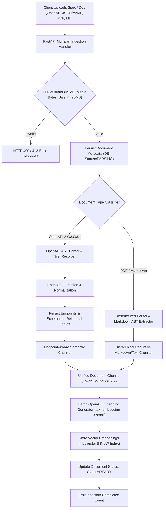
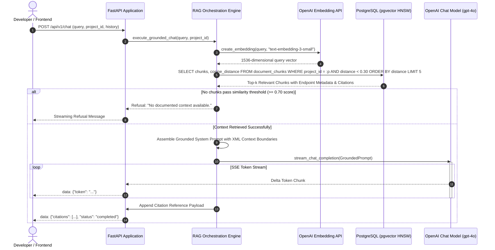
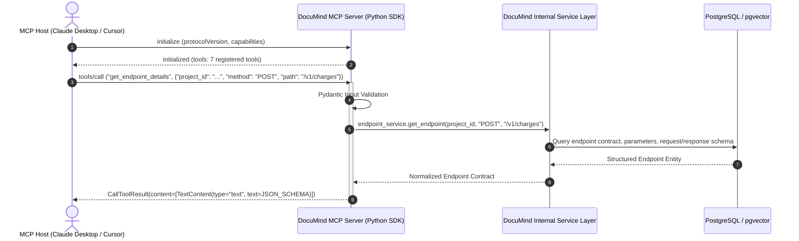
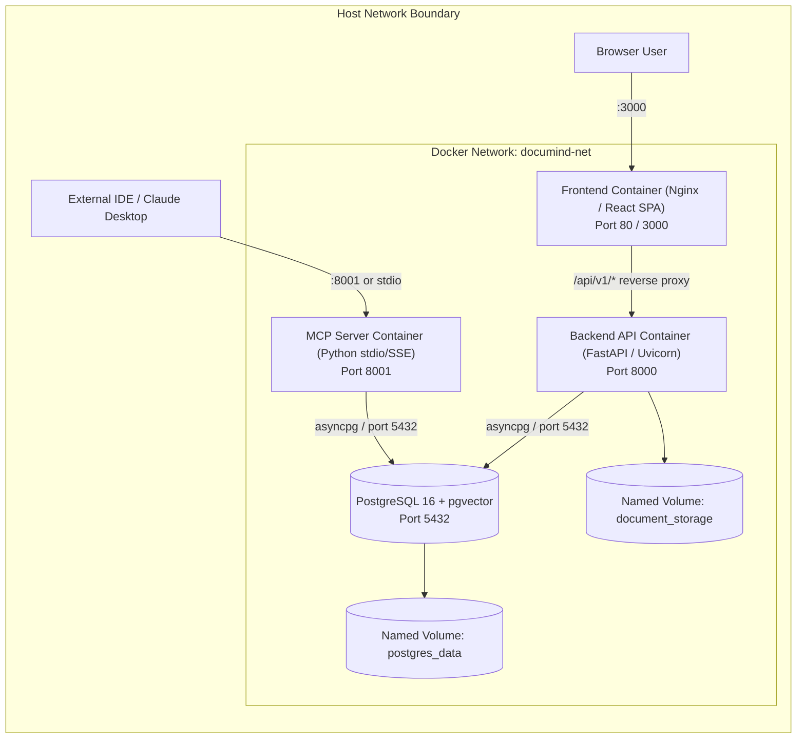

# DocuMind AI — System Architecture Specification

**Document Version:** 1.0.0  
**Architect:** Anmol Vishvas (anmol23vishvas@gmail.com)  
**Target Repository:** [https://github.com/anmolvishvas/DocuMind-AI](https://github.com/anmolvishvas/DocuMind-AI)  
**Default Branch:** `main`  
**System Status:** Architectural Baseline / Production Blueprint  

---

## 1. High-Level Architecture & System Topologies

DocuMind AI is architected as a modular, containerized multi-tier system composed of an asynchronous API gateway, domain-driven backend services, a unified relational and vector storage engine, a dedicated Model Context Protocol (MCP) server, and a developer-centric single-page application (SPA).

```
+----------------------------------------------------------------------------------------------------+
|                                      CLIENT INTERACTION TIER                                       |
|                                                                                                    |
|    +-----------------------------+                           +--------------------------------+    |
|    |      Web Browser User       |                           |  External AI Developer Client  |    |
|    |   (React 18+ / TypeScript)  |                           |  (Claude Desktop, Cursor, IDE) |    |
|    +--------------+--------------+                           +---------------+----------------+    |
|                   |                                                          |                     |
|                   | HTTPS / SSE (EventStream)                                | stdio / SSE (JSON)  |
|                   v                                                          v                     |
|    +-----------------------------+                           +--------------------------------+    |
|    |      Reverse Proxy          |                           |      DocuMind MCP Server       |    |
|    |  (Nginx / Traefik / Docker) |                           |   (Official MCP Python SDK)    |    |
|    +--------------+--------------+                           +---------------+----------------+    |
+-------------------|----------------------------------------------------------|---------------------+
                    |                                                          |
                    | Proxy Forward                                            | Internal Service API
                    v                                                          v
+----------------------------------------------------------------------------------------------------+
|                                    APPLICATION & SERVICE TIER                                      |
|                                                                                                    |
|  +----------------------------------------------------------------------------------------------+  |
|  |                             FastAPI Core Application Gateway                                 |  |
|  |    - CORS & Security Middleware    - Pydantic v2 Request/Response Validation                 |  |
|  |    - Correlation ID Tracking      - JWT / Project Context Injection                         |  |
|  +----------------------------------------------------------------------------------------------+  |
|           |                                       |                                    |           |
|           v                                       v                                    v           |
|  +------------------+                    +------------------+                +------------------+  |
|  | Document         |                    | RAG & Vector     |                | API Catalog &    |  |
|  | Ingestion Engine |                    | Retrieval Service|                | Schema Service   |  |
|  +--------+---------+                    +--------+---------+                +--------+---------+  |
|           |                                       |                                   |            |
|           | OpenAPI / PDF / MD                    | Embeddings & Retrieval            | Relational |
|           v                                       v                                   | Queries    |
|  +------------------+                    +------------------+                         |            |
|  | Endpoint-Aware   |                    | OpenAI Provider  |                         |            |
|  | Chunking Engine  |                    | (Embeddings &    |                         |            |
|  +--------+---------+                    | Completions)     |                         |            |
|           |                              +--------+---------+                         |            |
+-----------|---------------------------------------|-----------------------------------|------------+
            |                                       |                                   |
            v                                       v                                   v
+----------------------------------------------------------------------------------------------------+
|                                   DATA & PERSISTENCE TIER                                          |
|                                                                                                    |
|  +----------------------------------------------------------------------------------------------+  |
|  |                           PostgreSQL 16 + pgvector Extension                                 |  |
|  |    - Relational Storage: Projects, Documents, Endpoints, Parameters, Request/Response Schema |  |
|  |    - Vector Storage: Document Chunks, 1536-dim Embeddings with HNSW Index                    |  |
|  |    - ACID Transactions, Cascade Deletions, SQLAlchemy 2.0 Async Session Management           |  |
|  +----------------------------------------------------------------------------------------------+  |
+----------------------------------------------------------------------------------------------------+
```

---

### 1.1 Detailed Subsystem Data Flows

#### 1.1.1 Document Ingestion Pipeline Flow


#### 1.1.2 RAG Retrieval and Generation Pipeline Flow


#### 1.1.3 MCP Client-Server Communication Flow


#### 1.1.4 Docker Deployment Topology


---

## 2. Core Subsystems & Architectural Boundaries

DocuMind AI is decomposed into 15 cohesive subsystems with strictly enforced boundaries:

```
+----------------------------------------------------------------------------------------------------+
|                                    SUBSYSTEM TAXONOMY                                              |
|                                                                                                    |
|  [PRESENTATION LAYER]                                                                              |
|    1. Frontend Presentation Layer (React 18, TypeScript, Tailwind CSS, Vite)                       |
|                                                                                                    |
|  [APPLICATION & GATEWAY LAYER]                                                                     |
|    2. FastAPI Core Application Layer (Routing, Dependency Injection, Middleware, Error Handlers)   |
|    3. Authentication & Tenant Authorization Layer (Project Scopes, API Keys, Rate Limiting)       |
|                                                                                                    |
|  [INGESTION & PARSING SUBSYSTEM]                                                                   |
|    4. Document Ingestion Subsystem (Upload validation, MIME-sniffing, UUID file staging)           |
|    5. OpenAPI Specification Parser (Swagger 2.0 / OpenAPI 3.0/3.1 AST, $ref dereferencing)         |
|    6. Document Normalization & Chunking Engine (Endpoint-aware chunker, Markdown AST chunker)     |
|                                                                                                    |
|  [RAG & VECTOR RETRIEVAL SUBSYSTEM]                                                                |
|    7. Embedding Generation Service (OpenAI text-embedding-3-small, batching, caching)             |
|    8. Vector Retrieval Subsystem (pgvector HNSW cosine distance, metadata filtering)               |
|    9. RAG Orchestration Service (Context assembly, token budgeting, prompt grounding)              |
|    10. LLM Integration Layer (OpenAI gpt-4o/mini client, structured output parser, SSE streamer)  |
|                                                                                                    |
|  [EXPLORER & AGENTIC INTERFACE LAYER]                                                              |
|    11. API Explorer Subsystem (Endpoint catalog, JSON schema tree viewer, cURL generator)         |
|    12. MCP Server (Official Python MCP SDK, stdio/SSE transports, 7 standard tools)                |
|                                                                                                    |
|  [INFRASTRUCTURE & OPERATIONAL LAYER]                                                              |
|    13. PostgreSQL Persistence Layer (PostgreSQL 16, pgvector, SQLAlchemy 2.0 Async, Alembic)       |
|    14. Background Processing Subsystem (Async task execution for batch document indexing)          |
|    15. Logging, Monitoring & Observability (Structured JSON logs, correlation IDs, health checks)   |
+----------------------------------------------------------------------------------------------------+
```

### 2.1 Subsystem Details & Responsibilities

1. **Frontend Presentation Layer (`frontend/`):**
   - Implemented in React 18, TypeScript, Vite, and Tailwind CSS.
   - Provides responsive layout, dark/light themes, real-time SSE streaming chat, interactive JSON schema viewers, and API Explorer.
   - Communicates exclusively via HTTP/REST and SSE to the backend API.

2. **FastAPI Application Layer (`backend/app/api/`):**
   - Exposes RESTful endpoints versioned under `/api/v1`.
   - Coordinates business workflows using FastAPI's dependency injection (`Depends`).
   - Guarantees strict input and output validation via Pydantic v2 schemas.
   - Enforces uniform error handling, correlation IDs (`X-Correlation-ID`), and request timing.

3. **Authentication & Authorization Layer (`backend/app/core/security.py`):**
   - Manages API key verification and project-level tenant context.
   - Enforces that every document, endpoint, chunk, and vector query is bounded to an explicit `project_id`.

4. **Document Ingestion Subsystem (`backend/app/ingestion/`):**
   - Validates file streams against extension, content length, and magic numbers (PDF magic bytes `%PDF-`, JSON/YAML text structure).
   - Stages raw files to a secured volume directory using UUID filenames to prevent path traversal attacks.

5. **OpenAPI Specification Parser (`backend/app/ingestion/openapi_parser.py`):**
   - Parses OpenAPI 3.0.x, 3.1.x, and Swagger 2.0 JSON and YAML definitions.
   - Resolves internal schema references (`$ref: "#/components/schemas/User"`) into self-contained models.
   - Extracts endpoints, HTTP methods, paths, tags, operation IDs, headers, parameters, request body models, and status-coded response schemas.

6. **Document Normalization & Chunking Engine (`backend/app/rag/chunking.py`):**
   - Discards arbitrary fixed-character splitting for API specs.
   - Executes **Endpoint-Aware Chunking**, synthesizing a comprehensive Markdown and JSON representation for each endpoint containing its route signature, parameters, and schemas.
   - Implements recursive token-based chunking (512 tokens, 64 overlap) for narrative Markdown and PDF developer documentation.

7. **Embedding Generation Service (`backend/app/rag/embeddings.py`):**
   - Interfaces with OpenAI's `text-embedding-3-small` (1536 dimensions).
   - Batches chunk embeddings (up to 64 chunks per API call) to optimize network round-trips and handle rate limits with exponential backoff.

8. **Vector Retrieval Subsystem (`backend/app/rag/retriever.py`):**
   - Performs exact and semantic similarity searches against PostgreSQL using the `pgvector` extension.
   - Utilizes HNSW indexing configured for cosine distance (`<=>`).
   - Applies strict SQL `WHERE` clauses for `project_id` and optional metadata tags before vector distance ranking.

9. **RAG Orchestration Service (`backend/app/rag/service.py`):**
   - Evaluates retrieved chunk similarity scores against the minimum threshold ($0.70$ cosine similarity).
   - Formulates grounded system prompts injecting retrieved context inside `<api_context>` boundaries.
   - Enforces citation resolution, attaching precise document names and route paths to generated responses.

10. **LLM Integration Layer (`backend/app/core/llm.py`):**
    - Manages OpenAI client connections (`gpt-4o` and `gpt-4o-mini`).
    - Exposes asynchronous streaming generators yielding SSE token frames.
    - Handles retry logic, token budget capping, and fallback refusal responses when context is missing.

11. **API Explorer Subsystem (`backend/app/api/v1/explorer.py`):**
    - Serves queryable endpoint listings, schema hierarchies, and parameter matrices to the frontend and MCP clients.
    - Provides real-time filtering by HTTP method, tag, and path prefix.

12. **MCP Server (`backend/app/mcp/`):**
    - Implemented with the official Python `mcp` library.
    - Exposes DocuMind capabilities as standard MCP tools (`search_api_docs`, `list_api_endpoints`, `get_endpoint_details`, etc.).
    - Enables IDEs (Claude Desktop, Cursor) to directly query the documentation engine without UI context-switching.

13. **PostgreSQL Persistence Layer (`backend/app/models/`):**
    - Stores structured entities (`projects`, `documents`, `endpoints`, `document_chunks`) and vector representations.
    - Managed via SQLAlchemy 2.0 Async ORM with `asyncpg` driver and Alembic schema migrations.

14. **Background Processing Subsystem (`backend/app/core/tasks.py`):**
    - Handles CPU-intensive parsing and batch embedding generation off the main async request loop using FastAPI `BackgroundTasks` or thread pool executors (`run_in_threadpool`).

15. **Logging, Monitoring & Observability (`backend/app/core/logging.py`):**
    - Structured JSON logs with timestamp, log level, correlation ID, project ID, and module name.
    - Health endpoints (`/health`, `/ready`) validating database connectivity and pgvector readiness.

---

## 3. Technology Decisions & Trade-off Matrix

| Technology | Responsibility | Selection Rationale | Alternatives Considered | Trade-offs & Mitigation |
| :--- | :--- | :--- | :--- | :--- |
| **FastAPI** | REST API Gateway & Web Framework | Native Python async/await; automatic OpenAPI documentation; built-in dependency injection; first-class Pydantic integration. | Flask, Django, Go Gin | *Trade-off:* Python async event loop blocking risks.<br/>*Mitigation:* Offload CPU-heavy parsing to thread pools. |
| **PostgreSQL 16 + pgvector** | Unified Relational & Vector Storage | Eliminates dual-database operational overhead (no separate Pinecone/Qdrant needed); transactional consistency (ACID) across documents, endpoints, and vectors; proven enterprise stability. | Pinecone, Qdrant, ChromaDB, Weaviate | *Trade-off:* HNSW indexing requires sufficient RAM; indexing slower than dedicated C++ engines.<br/>*Mitigation:* Tune `m` and `ef_construction` parameters; allocate dedicated memory buffer. |
| **SQLAlchemy 2.0 + asyncpg** | Async ORM & Database Driver | High-performance asynchronous PostgreSQL driver; strict Python typing with `Mapped[]` and `mapped_column()`; seamless Alembic migration integration. | Tortoise ORM, Prisma Python, raw SQL | *Trade-off:* Steeper learning curve for 2.0 style async session mechanics.<br/>*Mitigation:* Strict repository pattern abstraction. |
| **Pydantic v2** | Data Validation & Schema Enforcement | Core rewritten in Rust (5-10x performance boost); strict type coercion; native JSON Schema serialization matching OpenAPI specs. | Marshmallow, Cerberus | *Trade-off:* Migration quirks from v1.<br/>*Mitigation:* Standardize on pure Pydantic v2 conventions from day one. |
| **OpenAI API (gpt-4o, text-embedding-3-small)** | RAG Embeddings & Grounded Generation | `text-embedding-3-small` delivers superior dimension/cost/accuracy ratio (1536 dims); `gpt-4o` provides industry-leading reasoning over nested JSON schemas. | Anthropic Claude, Local Ollama/Mistral, HuggingFace | *Trade-off:* External API dependency and per-token costs.<br/>*Mitigation:* Strict token budgeting, batching, and isolated LLM interface wrapper. |
| **Official MCP Python SDK** | Agent Tool Protocol Server | Emerging open standard backed by Anthropic and industry partners for connecting AI agents to external tools and data sources. | Custom REST Webhooks, LangChain Tools | *Trade-off:* Protocol specification is evolving.<br/>*Mitigation:* Pin official SDK version; encapsulate tools behind clean domain services. |
| **React 18 + TypeScript + Tailwind** | Frontend Developer Dashboard | Massive ecosystem; component-level reactivity; type safety matching backend Pydantic models; utility-first CSS for developer tool design. | Vue.js, Svelte, Next.js | *Trade-off:* Client-side rendering initial bundle size.<br/>*Mitigation:* Code splitting and Vite optimized bundling. |
| **Docker & Docker Compose** | Containerization & Local Dev Parity | Single-command developer setup; identical local and CI environments; deterministic dependency isolation. | Kubernetes, Podman, Bare Metal | *Trade-off:* Resource footprint on local machines.<br/>*Mitigation:* Multi-stage slim Docker builds with resource constraints. |
| **Pytest + Ruff + mypy** | Quality Assurance & Testing Suite | Ruff executes 10-100x faster than Flake8/Black; strict mypy catches type mismatches at compile time; Pytest provides clean fixture ecosystem. | Flake8, Black, Pylint | *Trade-off:* Strict mypy requires rigorous typing discipline.<br/>*Mitigation:* Comprehensive rulebook in `docs/RULES.md`. |

---

## 4. RAG Architecture: Endpoint-Aware Document Intelligence

### 4.1 The Fundamental Flaw of Naive Chunking for APIs
Traditional RAG architectures chunk text using fixed character counts (e.g. 500 characters) or sliding token windows. For API documentation, naive chunking fails catastrophically:
- An endpoint signature (`POST /api/v1/payments`) gets separated from its required request body fields.
- Deeply nested `$ref` schema definitions are split across chunks, resulting in incomplete JSON representations.
- Error codes (400, 422) lose their association with the originating endpoint.

### 4.2 Endpoint-Aware Semantic Chunking Strategy
DocuMind AI solves this with **Endpoint-Aware Chunking**:

```
+----------------------------------------------------------------------------------------------------+
|                                    STRUCTURED OPENAPI SPECIFICATION                                |
+----------------------------------------------------------------------------------------------------+
                                                  |
                                                  v
+----------------------------------------------------------------------------------------------------+
|                                    OPENAPI SPEC NORMALIZER                                         |
|    - Resolve all internal $ref pointers                                                            |
|    - Dereference components.schemas into standalone structures                                     |
+----------------------------------------------------------------------------------------------------+
                                                  |
                                                  v
+----------------------------------------------------------------------------------------------------+
|                                   ENDPOINT EXTRACTION ENGINE                                       |
|    Identifies each distinct Method + Route Path pair: (e.g., POST /v1/customers)                   |
+----------------------------------------------------------------------------------------------------+
                                                  |
                                                  v
+----------------------------------------------------------------------------------------------------+
|                                SYNTHETIC MARKDOWN & SCHEMA CHUNKER                                 |
|                                                                                                    |
|  Chunk Content Structure:                                                                          |
|  ```markdown                                                                                       |
|  # Endpoint: POST /v1/customers                                                                    |
|  Summary: Create a customer record                                                                 |
|  Description: Registers a new customer and sets default billing preferences.                       |
|  Tags: [Customers, Billing]                                                                       |
|  Authentication: Bearer Token (Scope: customers:write)                                             |
|                                                                                                    |
|  ## Parameters:                                                                                    |
|  - Idempotency-Key (header, string, optional)                                                     |
|                                                                                                    |
|  ## Request Body (application/json):                                                               |
|  - email (string, required): Customer email address                                                |
|  - name (string, required): Full legal name                                                        |
|  - metadata (object, optional): Key-value attributes                                               |
|                                                                                                    |
|  ## Responses:                                                                                     |
|  - 201 Created: Returns Customer Object {id, email, name, created_at}                             |
|  - 400 Bad Request: Missing required fields                                                        |
|  - 409 Conflict: Customer with email already exists                                                |
|  ```                                                                                               |
|                                                                                                    |
|  Metadata Envelope:                                                                                |
|  {                                                                                                 |
|    "project_id": "proj_123",                                                                       |
|    "document_id": "doc_456",                                                                       |
|    "chunk_type": "endpoint",                                                                       |
|    "http_method": "POST",                                                                          |
|    "route_path": "/v1/customers",                                                                  |
|    "tags": ["Customers", "Billing"],                                                              |
|    "token_count": 285                                                                              |
|  }                                                                                                 |
+----------------------------------------------------------------------------------------------------+
```

### 4.3 Database Schema for Vector and Relational Storage
```sql
-- Enable the vector extension
CREATE EXTENSION IF NOT EXISTS vector;

-- Projects Table (Tenant Partitioning)
CREATE TABLE projects (
    id VARCHAR(36) PRIMARY KEY,
    name VARCHAR(255) NOT NULL,
    description TEXT,
    created_at TIMESTAMP WITH TIME ZONE DEFAULT CURRENT_TIMESTAMP,
    updated_at TIMESTAMP WITH TIME ZONE DEFAULT CURRENT_TIMESTAMP
);

-- Documents Table
CREATE TABLE documents (
    id VARCHAR(36) PRIMARY KEY,
    project_id VARCHAR(36) NOT NULL REFERENCES projects(id) ON DELETE CASCADE,
    filename VARCHAR(255) NOT NULL,
    file_type VARCHAR(50) NOT NULL, -- 'openapi_json', 'openapi_yaml', 'pdf', 'markdown'
    storage_path VARCHAR(512) NOT NULL,
    status VARCHAR(50) NOT NULL DEFAULT 'PENDING', -- PENDING, PARSING, INDEXING, READY, FAILED
    error_message TEXT,
    created_at TIMESTAMP WITH TIME ZONE DEFAULT CURRENT_TIMESTAMP,
    updated_at TIMESTAMP WITH TIME ZONE DEFAULT CURRENT_TIMESTAMP
);

-- Endpoints Catalog Table (Relational Query Layer)
CREATE TABLE endpoints (
    id VARCHAR(36) PRIMARY KEY,
    project_id VARCHAR(36) NOT NULL REFERENCES projects(id) ON DELETE CASCADE,
    document_id VARCHAR(36) NOT NULL REFERENCES documents(id) ON DELETE CASCADE,
    http_method VARCHAR(10) NOT NULL, -- GET, POST, PUT, DELETE, PATCH, etc.
    route_path VARCHAR(512) NOT NULL,
    summary TEXT,
    description TEXT,
    operation_id VARCHAR(255),
    tags JSONB DEFAULT '[]'::jsonb,
    parameters JSONB DEFAULT '[]'::jsonb,
    request_body JSONB DEFAULT '{}'::jsonb,
    responses JSONB DEFAULT '{}'::jsonb,
    security JSONB DEFAULT '[]'::jsonb,
    created_at TIMESTAMP WITH TIME ZONE DEFAULT CURRENT_TIMESTAMP
);

-- Document Chunks Table (Vector Search Layer)
CREATE TABLE document_chunks (
    id VARCHAR(36) PRIMARY KEY,
    project_id VARCHAR(36) NOT NULL REFERENCES projects(id) ON DELETE CASCADE,
    document_id VARCHAR(36) NOT NULL REFERENCES documents(id) ON DELETE CASCADE,
    endpoint_id VARCHAR(36) REFERENCES endpoints(id) ON DELETE CASCADE,
    chunk_type VARCHAR(50) NOT NULL, -- 'endpoint', 'schema', 'narrative'
    content TEXT NOT NULL,
    token_count INTEGER NOT NULL,
    metadata JSONB NOT NULL DEFAULT '{}'::jsonb,
    embedding vector(1536), -- OpenAI text-embedding-3-small dimension
    created_at TIMESTAMP WITH TIME ZONE DEFAULT CURRENT_TIMESTAMP
);

-- HNSW Vector Index for Sub-second Cosine Similarity Search
CREATE INDEX idx_document_chunks_embedding_hnsw 
ON document_chunks 
USING hnsw (embedding vector_cosine_ops)
WITH (m = 16, ef_construction = 64);

-- Indexes for Fast Project-Partitioned Queries
CREATE INDEX idx_documents_project_id ON documents(project_id);
CREATE INDEX idx_endpoints_project_id ON endpoints(project_id);
CREATE INDEX idx_endpoints_method_path ON endpoints(project_id, http_method, route_path);
CREATE INDEX idx_document_chunks_project_id ON document_chunks(project_id);
```

### 4.4 Hallucination Mitigation & Grounding Rules
To prevent the LLM from hallucinating parameters, fake endpoints, or incorrect status codes:
1. **Fenced System Prompt:** Context is injected inside `<api_documentation>` tags with strict instruction to rely solely on the facts presented within the tags.
2. **Strict Negative Refusal:** The prompt instructs: *"If the question asks about an endpoint, parameter, or behavior not explicitly documented in the provided context, you must state: 'The provided documentation does not contain information regarding [topic].' Do not extrapolate, assume, or invent specifications."*
3. **Structured Citation Protocol:** The LLM is instructed to append citation identifiers `[Doc: <filename> | Route: <METHOD /path>]` to any technical assertion.

---

## 5. Model Context Protocol (MCP) Architecture

### 5.1 Protocol Overview
The **Model Context Protocol (MCP)** is an open standard that allows AI applications (such as Claude Desktop, Cursor, or autonomous agent workflows) to connect to external data sources and tools through a standardized client-server protocol.

DocuMind AI provides an official MCP server implementation residing in `backend/app/mcp/`.

### 5.2 Server Registration & Capabilities
The DocuMind MCP Server implements the standard MCP protocol:
- **Protocol Version:** `2024-11-05`
- **Supported Transports:**
  - `stdio`: Local execution via child process for desktop IDE integrations.
  - `SSE` (Server-Sent Events): Remote HTTP transport for networked agent architectures.
- **Server Capabilities:** `tools` (list, call).

### 5.3 Initial 7 MCP Tools Specification

#### Tool 1: `search_api_docs`
- **Description:** Performs natural language semantic search across the indexed documentation for a given project.
- **Input Schema:**
  ```json
  {
    "type": "object",
    "properties": {
      "project_id": { "type": "string", "description": "Target project UUID" },
      "query": { "type": "string", "description": "Natural language technical query" },
      "limit": { "type": "integer", "default": 5, "description": "Maximum chunks to retrieve" }
    },
    "required": ["project_id", "query"]
  }
  ```
- **Output:** Array of matching chunks with similarity scores, route paths, and text excerpts.

#### Tool 2: `list_api_endpoints`
- **Description:** Lists all available API endpoints in a project, with optional filtering by HTTP method, tag, or path keyword.
- **Input Schema:**
  ```json
  {
    "type": "object",
    "properties": {
      "project_id": { "type": "string", "description": "Target project UUID" },
      "method": { "type": "string", "enum": ["GET", "POST", "PUT", "DELETE", "PATCH"], "description": "Optional HTTP method filter" },
      "tag": { "type": "string", "description": "Optional category tag filter" },
      "path_prefix": { "type": "string", "description": "Optional path prefix (e.g. /v1/orders)" }
    },
    "required": ["project_id"]
  }
  ```
- **Output:** Array of endpoint summaries containing method, path, summary, and operation ID.

#### Tool 3: `get_endpoint_details`
- **Description:** Retrieves the complete specification for a specific endpoint, including descriptions, parameters, headers, authentication, and responses.
- **Input Schema:**
  ```json
  {
    "type": "object",
    "properties": {
      "project_id": { "type": "string", "description": "Target project UUID" },
      "method": { "type": "string", "description": "HTTP Method (e.g., POST)" },
      "route_path": { "type": "string", "description": "Exact route path (e.g., /v1/customers)" }
    },
    "required": ["project_id", "method", "route_path"]
  }
  ```
- **Output:** Complete endpoint contract object.

#### Tool 4: `get_request_schema`
- **Description:** Returns the JSON schema for the request body of a specified endpoint and content type.
- **Input Schema:**
  ```json
  {
    "type": "object",
    "properties": {
      "project_id": { "type": "string", "description": "Target project UUID" },
      "method": { "type": "string", "description": "HTTP Method" },
      "route_path": { "type": "string", "description": "Route path" },
      "content_type": { "type": "string", "default": "application/json" }
    },
    "required": ["project_id", "method", "route_path"]
  }
  ```
- **Output:** Dereferenced JSON Schema definition for the request body.

#### Tool 5: `get_response_schema`
- **Description:** Returns the response JSON schema and header definitions for a specific status code on an endpoint.
- **Input Schema:**
  ```json
  {
    "type": "object",
    "properties": {
      "project_id": { "type": "string", "description": "Target project UUID" },
      "method": { "type": "string", "description": "HTTP Method" },
      "route_path": { "type": "string", "description": "Route path" },
      "status_code": { "type": "string", "default": "200", "description": "Target HTTP status code (e.g., 200, 201, 400)" }
    },
    "required": ["project_id", "method", "route_path"]
  }
  ```
- **Output:** Dereferenced JSON Schema definition for the response body.

#### Tool 6: `generate_code_example`
- **Description:** Generates an idiomatic, syntax-checked code example in Python, JavaScript, or cURL for calling the specified endpoint.
- **Input Schema:**
  ```json
  {
    "type": "object",
    "properties": {
      "project_id": { "type": "string", "description": "Target project UUID" },
      "method": { "type": "string", "description": "HTTP Method" },
      "route_path": { "type": "string", "description": "Route path" },
      "language": { "type": "string", "enum": ["python", "javascript", "curl"], "description": "Target programming language" }
    },
    "required": ["project_id", "method", "route_path", "language"]
  }
  ```
- **Output:** Formatted code snippet string with sample variable placeholders.

#### Tool 7: `explain_api_error`
- **Description:** Analyzes an HTTP error status code or error payload against the documented error schemas and returns diagnosis and suggested remediation.
- **Input Schema:**
  ```json
  {
    "type": "object",
    "properties": {
      "project_id": { "type": "string", "description": "Target project UUID" },
      "method": { "type": "string", "description": "HTTP Method of the failed request" },
      "route_path": { "type": "string", "description": "Route path of the failed request" },
      "status_code": { "type": "integer", "description": "Observed HTTP status code" },
      "error_payload": { "type": "string", "description": "Raw JSON error response body from API" }
    },
    "required": ["project_id", "method", "route_path", "status_code"]
  }
  ```
- **Output:** Structured diagnostic analysis detailing probable root cause and remediation steps based on documented specs.

---

## 6. Monorepo Project Directory Structure

```
DocuMind-AI/
├── .github/
│   ├── workflows/
│   │   ├── ci.yml                     # Master CI: Lint, Typecheck, Test, Security, Docker
│   │   └── pr-audit.yml               # PR Governance: Conventional Commits, Path Labeling
│   └── PULL_REQUEST_TEMPLATE.md       # Standardized Senior Engineering PR Template
├── docs/
│   ├── PRD.md                         # Product Requirements Document
│   ├── ARCHITECTURE.md                # System Architecture & Technical Specifications
│   ├── RULES.md                       # Engineering Rulebook & Contributor Standards
│   ├── DESIGN.md                      # UI/UX Specification & Design System
│   ├── TASKS.md                       # Phased Implementation Roadmap
│   └── MEMORY.md                      # Living Project Journal & ADR Log
├── backend/
│   ├── pyproject.toml                 # Backend dependencies, Ruff, mypy, pytest configs
│   ├── Dockerfile                     # Multi-stage production container build
│   ├── alembic.ini                    # Database migration configuration
│   ├── alembic/
│   │   ├── env.py                     # Async migration runner environment
│   │   ├── script.py.mako             # Migration template
│   │   └── versions/                  # Database migration revision files
│   └── app/
│       ├── __init__.py
│       ├── main.py                    # FastAPI Application Entrypoint & Middleware Setup
│       ├── core/                      # Cross-cutting foundational modules
│       │   ├── __init__.py
│       │   ├── config.py              # Pydantic BaseSettings environment config
│       │   ├── database.py            # Async SQLAlchemy engine & session factory
│       │   ├── exceptions.py          # Custom domain exception hierarchy
│       │   ├── logging.py             # Structured JSON logger configuration
│       │   └── security.py            # Secret validation & auth dependencies
│       ├── models/                    # SQLAlchemy 2.0 Declarative ORM Models
│       │   ├── __init__.py
│       │   ├── base.py                # Base model with UUID and timestamp helpers
│       │   ├── project.py             # Project & Workspace model
│       │   ├── document.py            # Uploaded Document entity
│       │   ├── endpoint.py            # OpenAPI Extracted Endpoint entity
│       │   └── chunk.py               # Vector Chunk entity with pgvector column
│       ├── schemas/                   # Pydantic v2 Request/Response Schemas
│       │   ├── __init__.py
│       │   ├── project.py             # Project creation & response DTOs
│       │   ├── document.py            # Document upload & status DTOs
│       │   ├── endpoint.py            # Normalized Endpoint representation DTOs
│       │   ├── chat.py                # Chat request, streaming, and citation DTOs
│       │   └── mcp.py                 # MCP tool argument & return DTOs
│       ├── api/                       # API Route Controllers (Thin layer)
│       │   ├── __init__.py
│       │   ├── router.py              # Central v1 API router aggregator
│       │   └── v1/
│       │       ├── __init__.py
│       │       ├── health.py          # /health and /ready readiness probes
│       │       ├── projects.py        # Project CRUD routes
│       │       ├── documents.py       # Document upload and status routes
│       │       ├── explorer.py        # Endpoint catalog & schema viewer routes
│       │       └── chat.py            # Natural language Q&A and SSE streaming routes
│       ├── ingestion/                 # Document Ingestion & AST Parsers
│       │   ├── __init__.py
│       │   ├── validator.py           # MIME-type, magic bytes, and size verification
│       │   ├── openapi_parser.py      # OpenAPI 2.0/3.0/3.1 AST & $ref dereferencing
│       │   ├── markdown_parser.py     # Markdown hierarchy and code block extraction
│       │   └── pdf_parser.py          # PyPDF text and layout extractor
│       ├── rag/                       # RAG & Retrieval Engine
│       │   ├── __init__.py
│       │   ├── chunking.py            # Endpoint-aware and recursive token chunkers
│       │   ├── embeddings.py          # OpenAI text-embedding-3-small client
│       │   ├── retriever.py           # pgvector HNSW similarity queries
│       │   ├── prompts.py             # Grounded prompt templates & XML fencing
│       │   └── service.py             # RAG orchestrator coordinating search & LLM
│       └── mcp/                       # Model Context Protocol Server
│           ├── __init__.py
│           ├── server.py              # MCP server initialization & transport handler
│           └── tools.py               # Registration of 7 core developer MCP tools
├── frontend/
│   ├── package.json                   # React, Vite, Tailwind, Lucide dependencies
│   ├── tsconfig.json                  # Strict TypeScript configuration
│   ├── vite.config.ts                 # Vite bundler configuration & proxy setup
│   ├── tailwind.config.js             # Tailwind design tokens & theme extension
│   ├── postcss.config.js              # PostCSS plugins
│   ├── Dockerfile                     # Multi-stage Nginx production build
│   ├── nginx.conf                     # Production reverse proxy & SPA router
│   ├── index.html                     # HTML5 single-page application entrypoint
│   └── src/
│       ├── main.tsx                   # React root hydration
│       ├── App.tsx                    # Root routing & layout container
│       ├── index.css                  # Tailwind directives & global font styles
│       ├── api/                       # Typed HTTP API client & SSE consumer
│       │   ├── client.ts              # Fetch wrapper with error normalization
│       │   └── sse.ts                 # Server-Sent Events stream reader
│       ├── components/                # Reusable UI component library
│       │   ├── layout/                # Sidebar, Topbar, MainLayout
│       │   ├── explorer/              # EndpointCard, MethodBadge, SchemaViewer
│       │   ├── chat/                  # ChatContainer, MessageBubble, CitationChip
│       │   └── common/                # Button, Modal, Dropzone, SkeletonLoader
│       ├── pages/                     # Top-level view routes
│       │   ├── Dashboard.tsx          # Workspace overview & metrics
│       │   ├── ProjectsPage.tsx       # Project list & creation modal
│       │   ├── ExplorerPage.tsx       # Interactive API catalog & schema inspector
│       │   └── AssistantPage.tsx      # Full-page AI documentation assistant
│       └── types/                     # Shared TypeScript interface definitions
│           ├── project.ts
│           ├── endpoint.ts
│           └── chat.ts
├── tests/
│   ├── conftest.py                    # Pytest global fixtures, test DB, async client
│   ├── test_health.py                 # Smoke tests for health and readiness probes
│   ├── unit/                          # Isolated unit test suites
│   │   ├── test_openapi_parser.py     # Spec parsing and $ref resolution tests
│   │   ├── test_chunking.py           # Endpoint-aware chunking tests
│   │   └── test_security.py           # MIME-type and file upload validator tests
│   └── integration/                   # Cross-component integration test suites
│       ├── test_db_pgvector.py        # Vector similarity queries against real pgvector
│       ├── test_rag_pipeline.py       # End-to-end ingestion, retrieval & generation
│       └── test_mcp_tools.py          # MCP tool call execution tests
├── docker-compose.yml                 # Master local multi-container orchestration
├── docker-compose.override.yml.example# Developer local port override template
├── .env.example                       # Documented environment variable template
├── .gitignore                         # Comprehensive Git exclusions
└── README.md                          # Repository landing page & operational guide
```
